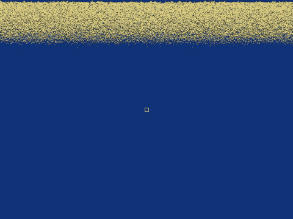

# Sandy

A falling-sand simulation written in **SystemVerilog**, simulated with **Verilator** and drawn to a window with **SDL2**. Every pixel of the 640x480 display is one sand cell, and the whole engine (cursor, gravity, probabilistic sand movement, double-buffered framebuffer) is hardware-style RTL that could be synthesised for an FPGA.

## Demo



MP4 version: [docs/demo.mp4](docs/demo.mp4)

In the clip: sand is poured at the cursor and swept to the right, then gravity is flipped to **right** (key `4`), **up** (key `2`) and back to **down** (key `1`) before a second sweep to the left.

## Controls

| Key | Action |
|---|---|
| Arrow keys | Move the spawn cursor |
| `S` (hold) | Spawn sand at the cursor (9x9 square) |
| `1` / `2` / `3` / `4` | Gravity down / up / left / right |
| `Q` or close window | Quit (prints the simulated frame rate) |

## Project layout

All sources live in `basic/`:

| File | Role |
|---|---|
| `top_sandy.sv` | Top level: wires the display timing, cursor, engine and framebuffer together |
| `engine_row.sv` | Sand engine used by the top level: moves a whole 640-cell row per clock with bitwise ops, with gravity, spawning and random dice rolls |
| `engine.sv` | Reference engine with the same interface and rules, one cell per clock |
| `prob_row.sv` | Random 640-bit rows where each bit is 1 with a given probability, built from xorshift32 generators |
| `cursor.sv` | Clamped cursor driven by the four direction buttons |
| `simple_480p.sv` | 640x480 display timing generator (sync, blanking, coordinates) |
| `main_sandy.cpp` | Verilator wrapper: clocks the design, copies the pixel stream into an SDL texture, maps keyboard to buttons |
| `makefile` | Builds `obj_dir/sandy` with Verilator + SDL2 |
| `shell.nix` | Optional Nix shell providing SDL2 (not required) |

## Building

### Linux / WSL

```sh
sudo apt install verilator libsdl2-dev build-essential   # Debian/Ubuntu
cd basic
make
./obj_dir/sandy
```

### Windows (MSYS2, no Nix needed)

1. Install [MSYS2](https://www.msys2.org/) and open the **UCRT64** shell.
2. Install the toolchain:

   ```sh
   pacman -S --needed make mingw-w64-ucrt-x86_64-gcc mingw-w64-ucrt-x86_64-python \
       mingw-w64-ucrt-x86_64-verilator mingw-w64-ucrt-x86_64-SDL2
   ```

3. Build and run from the same shell:

   ```sh
   cd basic
   make
   ./obj_dir/sandy.exe
   ```

   To launch `sandy.exe` from outside MSYS2 (Explorer, PowerShell), put `C:\msys64\ucrt64\bin` on `PATH` so `SDL2.dll` and the GCC runtime DLLs are found.

Two small portability tweaks are already in the tree for the MinGW toolchain: `main_sandy.cpp` defines the legacy `sc_time_stamp()` hook (PE has no weak undefined symbols), and the makefile builds the Verilator runtime with `OPT_GLOBAL=-O2` because MSYS2's GCC 16 fails to link `std::string` moves at `-Os`. Both are harmless on Linux.

## How it works

- `simple_480p` generates 640x480 timing. The display always scans out the front buffer, and the engine only flips its ping-pong buffers during vertical blanking so a frame is never torn.
- The grid is 1 bit per cell (air or sand), one 640-bit word per row, kept in two distributed RAMs. A simulation step walks the rows from the side gravity points at to the opposite side and processes each row in a few clocks using shifts and masks.
- Gravity is a pair of chances `(g_x, g_y)` of moving one cell along each axis. Falling, sideways pull, sliding off a blocked cell and the slide direction are each decided by a random row from `prob_row`, so piles form natural slopes and the four gravity directions share one set of rules.
- The SDL wrapper toggles `clk_pix` and reads `sdl_sx`/`sdl_sy`/`sdl_de` and the RGB outputs every cycle, exactly like a VGA monitor would, then presents the texture once per frame.
